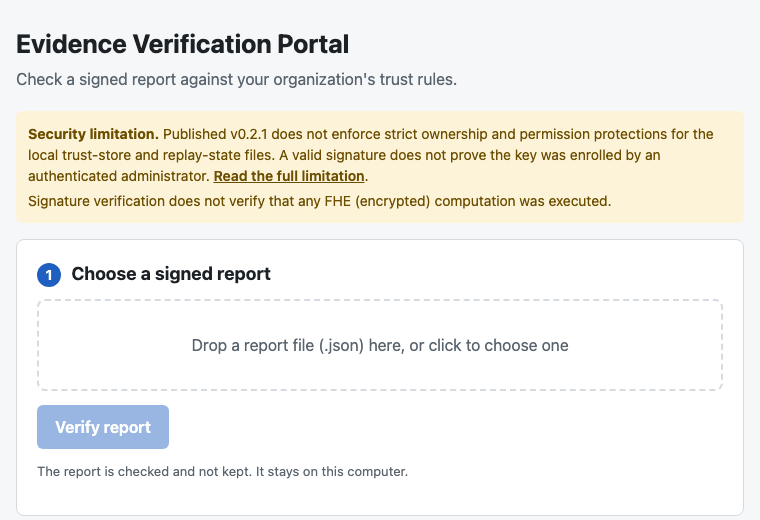
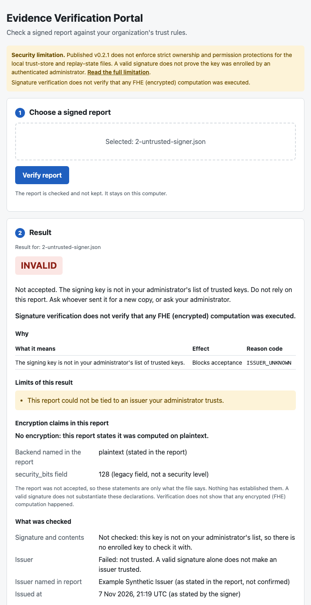
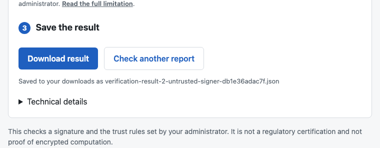

# regaudit-fhe

Depth-tracked regulatory audit primitives for privacy-preserving AI audits.

[](https://github.com/BAder82t/regaudit-fhe/actions/workflows/ci.yml)
[](https://pypi.org/project/regaudit-fhe/)
[](https://pypi.org/project/regaudit-fhe/)
[](https://github.com/BAder82t/regaudit-fhe/blob/master/LICENSE)

regaudit-fhe runs 6 audit calculations on an AI system: fairness, provenance, concordance, calibration, drift, and disagreement. Then it adds each result to a signed report that a regulator or auditor can check. A company can use it to show evidence on its model and the regulator would check this evidence with a list of keys it has approved.

The calculations will run on plaintext by default. An optional backend can be used to run these calculations on CKKS encrypted data. In its current form, the same process would hold the key and would be able to see both the inputs and the result. This is not yet a deployment where the data holder and the evaluator are different parties.

> **Status.** This is a reference implementation and the verification core is a candidate. It has not had any independent external security audit. It does not make anything compliant. A report would be technical evidence that may be used to support a workflow for compliance. See [what is and isn't validated](https://github.com/BAder82t/regaudit-fhe/blob/master/docs/STATUS.md) and [the compliance scope](https://github.com/BAder82t/regaudit-fhe/blob/master/COMPLIANCE.md).

## Install

```bash
pip install regaudit-fhe                # audit, sign, verify, CLI (Python 3.10 or newer)
pip install "regaudit-fhe[fhe]"         # adds the TenSEAL CKKS backend
pip install "regaudit-fhe[server]"      # adds the HTTP server
```

All the options are in [Installing and developing](https://github.com/BAder82t/regaudit-fhe/blob/master/docs/DEVELOPMENT.md).

## Sign and verify a report

```python
import numpy as np
import regaudit_fhe as rf

# The company: audit and sign. Use a long-lived key in a KMS or HSM in production.
y_true = np.array([1, 0, 1, 1, 0, 1, 0, 0], dtype=float)
y_pred = np.array([1, 0, 1, 0, 0, 1, 1, 0], dtype=float)
group_a = np.array([1, 1, 1, 1, 0, 0, 0, 0], dtype=float)
report = rf.audit_fairness(y_true, y_pred, group_a, 1.0 - group_a, threshold=0.1)

signer = rf.Signer.generate(issuer="acme-bank", key_id="acme-2026-04")
text = rf.envelope_v2("fairness", report, signer=signer, deployment_id="prod-eu-1",
                      audience=["regulator-a"]).to_json()

# The regulator: check it against keys it approved. Get the public key out of band, never from a report.
trust_store = rf.TrustStore.from_dict({"entries": {"acme-2026-04": {
    "issuer": "acme-bank", "public_key_pem": signer.public_key_pem(), "status": "active"}}})
policy = rf.VerificationPolicy(trust_store=trust_store, verifier_id="regulator-a")
result = rf.verify_report(rf.parse_envelope(text), policy)
print(result.accepted, result.trust_status, result.blocking_reasons)
```

The [command line](https://github.com/BAder82t/regaudit-fhe/blob/master/docs/CLI.md) does the same thing, and [this example](https://github.com/BAder82t/regaudit-fhe/blob/master/examples/strict_verification_quickstart.py) also shows forged and tampered reports.

## Evidence Verification Portal (experimental)

The [Evidence Verification Portal](https://github.com/BAder82t/regaudit-fhe/blob/master/portal/README.md) is a local browser page for checking a signed report without the command line. It is experimental. It calls the published `regaudit-fhe` 0.2.1 verifier and shows what it returns. It listens on `127.0.0.1` only and has no sign-in. It is not a regulatory certification and not proof of encrypted computation.

The verdict depends on the trusted issuers your administrator configured. A valid signature alone shows only that the report was not changed after it was signed. It does not establish who the issuer is, and it does not show that any encrypted computation happened. The screenshots below use a synthetic sample report, signed with a demonstration key, and a demonstration trust list made by the Portal's demo setup. The steps to run it with that sample data are in the [Portal guide](https://github.com/BAder82t/regaudit-fhe/blob/master/portal/README.md).

**1. Upload.** Choose a signed report file. Uploads are limited to 1 MB, checked and not kept.



*The start page before a report is chosen. The security limitation notice is on every page.*

**2. Verify.** Press **Verify report**. The verdict is the verifier's own `TRUSTED`, `SELF_SIGNED_ONLY` or `INVALID`, shown with the reason, the limits of the result and the encryption claims as the signer states them.



*A synthetic sample signed with a key that is not in the demonstration trust list. The verdict is INVALID with reason code ISSUER_UNKNOWN. The issuer name is shown as stated in the report, not confirmed.*

**3. Export.** Press **Download result** to save the result as a JSON file.



*The export step after Download result was pressed. The page names the saved file, here `verification-result-2-untrusted-signer-db1e36adac7f.json`, which comes from the same synthetic sample.*

Signature verification does not verify that any FHE (encrypted) computation was executed.

### Portal security limitation, published v0.2.1

Published regaudit-fhe v0.2.1 does not enforce the strict filesystem ownership and writable-permission protections for local trust-store and replay-state files introduced in the experimental code.

Users with sufficient filesystem access may be able to modify those files. A valid report signature does not prove that the signing key was enrolled by an authenticated administrator.

These protections are not included in the published v0.2.1 package. Do not rely on that version for security guarantees requiring them.

## What the answer means

The company runs an audit and signs the result with its private key. The regulator keeps its own list of approved keys called the trust store. A report cannot add itself to this list. The verifier can check the report against this list and give one of three answers.

| Answer | In plain words | What to do |
| --- | --- | --- |
| `TRUSTED` | An approved key signed it, it has not been altered, and every rule you set was met. | Accept it. |
| `SELF_SIGNED_ONLY` | It has not been altered, but you gave no list of approved keys, so you cannot tell who signed it. | Do not rely on it. |
| `INVALID` | It was altered, or the key is unknown, revoked or out of scope, or it is too old, replayed, or breaks a rule. | Reject it. `blocking_reasons` says why. |

Even `TRUSTED` says only that a key in your trust store signed the report, within its scope, with every policy rule met. It doesn't say that the audit is correct and it doesn't show that the calculation was done using FHE.

A report will contain the public key that can check its own signature. Anyone can make a report where the signature is consistent. Only a key that you registered beforehand will tell you who has signed the report. Decide on `result.accepted` or the exit code. Don't use the older `valid` field.

`regaudit-fhe verify` exits **0 only when the report is accepted**:

| Exit | Meaning |
| ---- | ------- |
| `0` | Accepted (`TRUSTED`). |
| `1` | A well-formed report refused by policy. |
| `2` | Invalid input, wrong usage or an incompatible combination of options. |
| `3` | A trust or verification resource you specified is unavailable or unusable. |

## What a report looks like

```json
{
  "schema": "regaudit-fhe.report.v2",
  "algorithm_version": "0.2.1",
  "primitive": "fairness",
  "backend": "plaintext",
  "result": { "breach": false, "disparity": 0.25 },
  "issuer": "acme-bank",
  "key_id": "acme-2026-04",
  "receipt": { "sha256": "26af001f…", "signature_alg": "Ed25519", "signature_b64": "lVI6L7um…" }
}
```

This is abridged. The full format is in [Report format and JSON schemas](https://github.com/BAder82t/regaudit-fhe/blob/master/docs/REPORT_FORMAT.md).

## Limits to know first

Replay detection is local to the verifier's own store. `RECORDED_LOCAL` means that this report was recorded in this store. `replay_durable` would indicate if this record would survive a restart. The storage check behind that is in the experimental code from pull request #65 and not in published v0.2.1. This is not global single-use protection.

A report signed with a retired or compromised key will be refused by default. Accepting one would need authenticated evidence that the signing time was strictly earlier than the retirement or compromise time. This release cannot authenticate a trust history.

`report.v1` is still verified but the `confidential` and `high-assurance` profiles refuse it due to the lack of a signed run id. Use `report.v2` for new work.

Four limitations of version 0.2.1 have their own advisory: [issuer attribution](https://github.com/BAder82t/regaudit-fhe/blob/master/docs/advisories/issuer-attribution-0.2.1.md), [replay protection](https://github.com/BAder82t/regaudit-fhe/blob/master/docs/advisories/replay-limitations-0.2.1.md), [trust store file permissions](https://github.com/BAder82t/regaudit-fhe/blob/master/docs/advisories/trust-store-permissions-0.2.1.md) and [replay file permissions](https://github.com/BAder82t/regaudit-fhe/blob/master/docs/advisories/replay-file-permissions-0.2.1.md).

## Documentation

| Read this | For |
| --- | --- |
| [Walkthrough](https://github.com/BAder82t/regaudit-fhe/blob/master/docs/WALKTHROUGH.md) | A hands-on run from key to verdict, with real output. |
| [Signing and verifying](https://github.com/BAder82t/regaudit-fhe/blob/master/docs/SIGN_AND_VERIFY.md) | The trust rules, reading a result, the older API, verifying over HTTP. |
| [Command line](https://github.com/BAder82t/regaudit-fhe/blob/master/docs/CLI.md) | Commands, options, full exit codes, server notes. |
| [Primitives](https://github.com/BAder82t/regaudit-fhe/blob/master/docs/PRIMITIVES.md) | The six calculations, depth, encrypted execution, benchmarks. |
| [Report format](https://github.com/BAder82t/regaudit-fhe/blob/master/docs/REPORT_FORMAT.md) | The signed report and the JSON schemas. |
| [Status](https://github.com/BAder82t/regaudit-fhe/blob/master/docs/STATUS.md) | What is checked, what is not provided, what ships. |
| [Compliance](https://github.com/BAder82t/regaudit-fhe/blob/master/COMPLIANCE.md) | What each calculation does not prove, by regulation. |
| [Threat model](https://github.com/BAder82t/regaudit-fhe/blob/master/docs/THREAT_MODEL.md), [Trust specification](https://github.com/BAder82t/regaudit-fhe/blob/master/docs/TRUST_SPEC.md) | The security model and the exact rules. |
| [Deployment](https://github.com/BAder82t/regaudit-fhe/blob/master/docs/DEPLOYMENT.md) | Running the server. Read this before exposing it. |
| [Development](https://github.com/BAder82t/regaudit-fhe/blob/master/docs/DEVELOPMENT.md), [Examples](https://github.com/BAder82t/regaudit-fhe/blob/master/examples/README.md) | Install options, code layout, runnable flows. |
| [Changelog](https://github.com/BAder82t/regaudit-fhe/blob/master/CHANGELOG.md), [Security](https://github.com/BAder82t/regaudit-fhe/blob/master/SECURITY.md) | Changes, and how to report a vulnerability. |

## License

Maintained by **VaultBytes Innovations Ltd**. **Dual-licensed**: AGPL-3.0-or-later (default, see [LICENSE](https://github.com/BAder82t/regaudit-fhe/blob/master/LICENSE)) or the **VaultBytes Commercial License** for deployments where AGPL is not workable (see [LICENSE-COMMERCIAL.md](https://github.com/BAder82t/regaudit-fhe/blob/master/LICENSE-COMMERCIAL.md), contact **b@vaultbytes.com**). Contributions are not accepted, see [CONTRIBUTING.md](https://github.com/BAder82t/regaudit-fhe/blob/master/CONTRIBUTING.md).
